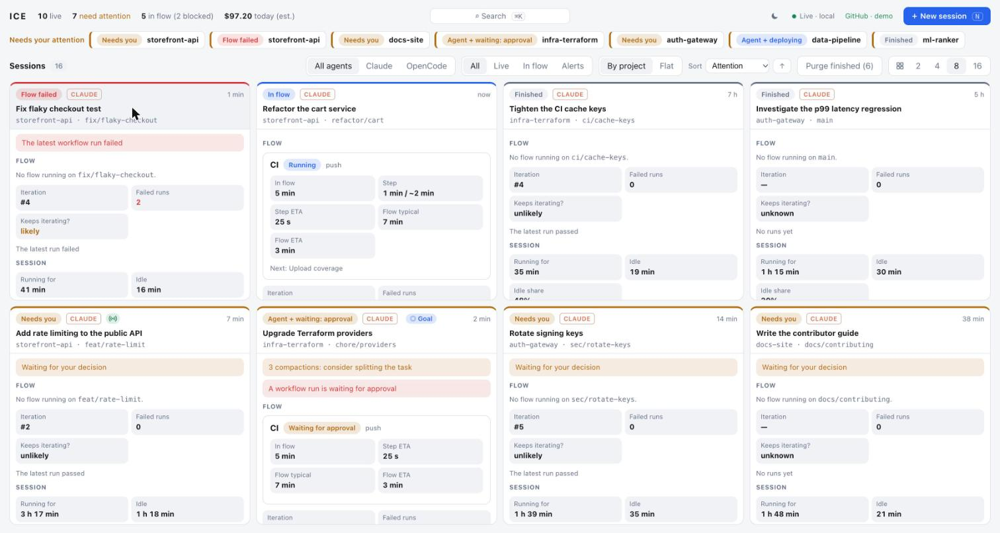
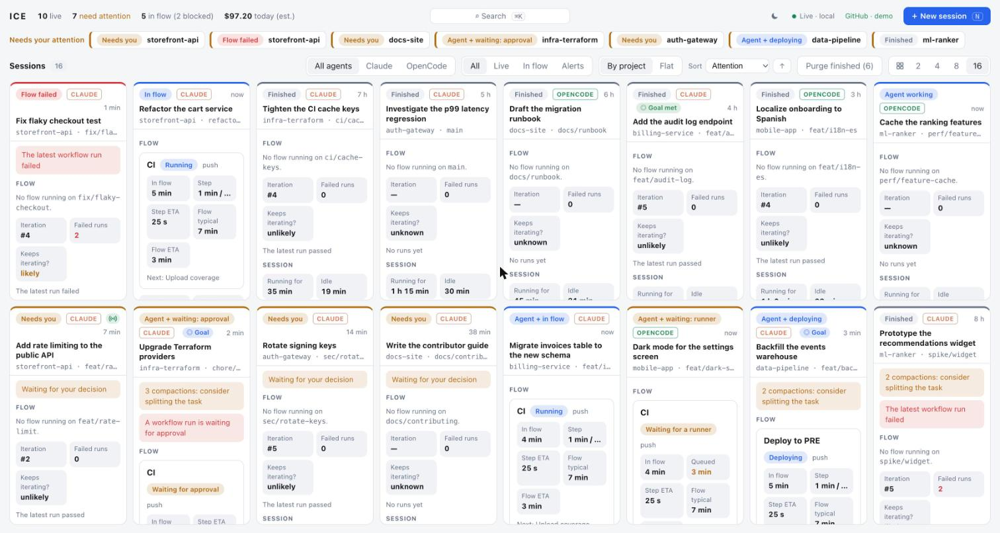
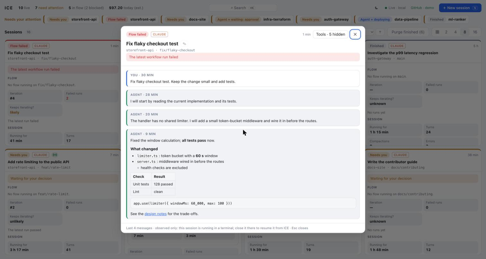

# ICE · Integrated Control Environment

A **local** web UI to supervise, and drive, your coding-agent sessions. It supports **Claude Code** and **OpenCode**.

This is the **Good ICE**: not the other ICE that has been in the news (U.S. Immigration and Customs Enforcement, no relation). It only supervises coding agents, runs on your own machine and answers to you.

## Control, not development

Agentic Development Environments (ADEs) such as VS Code Agents, Visual Studio 2026, Cursor 3 or JetBrains Air are built around *developing* with agents: launching them, giving them tasks, getting pull requests back. ICE is the other half, the **control** side, as argued in [El nuevo IDE](https://acasquetenotes.com/el-nuevo-ide) (in Spanish). It does not edit code or replace your editor or your agent. It sits beside them as a console for many sessions across many projects: who is working, who is waiting for you, what failed in CI, what it costs, and what needs a decision.



*Screenshots use [demo mode](docs/details.md#demo-mode): all sessions, projects and repositories are invented.*

## What it does

- **See everything at once.** Up to 16 sessions per screen (2, 4, 8 or 16), in a strip that scrolls sideways without limit. Each cell shows status, alerts, CI flow with ETA, PRs, tokens, cost and an 8-hour activity strip.
- **Know what needs you.** A bar lists sessions waiting for a decision, failed workflow runs, flows stuck on a runner or an approval, runaway cost and repeated compactions. Claude Code `/goal` is shown too.
- **Drive sessions without leaving the page.** Start sessions, answer permission prompts and questions, send messages (paste or drop screenshots, type `/` for commands and skills), interrupt, resume finished ones and rename them. Hosted sessions live in a separate daemon, so they survive restarting ICE.
- **Ready-made first messages.** Report on open issues and PRs, implement issues, implement one issue and deploy to PRE/PRO, or write a new issue and implement it in one long autonomous run.
- **Move around fast.** `⌘K` / `Ctrl+K` finds a session or project and centres it, `N` starts a new session; drag cells to rearrange them; they keep their position when statuses change.
- **Light and dark themes**, live updates, keyboard navigation.



Click a cell header to read the conversation, with Markdown rendered. Tool calls and their results are hidden by default; the **Tools** button shows them (and remembers your choice). Sessions that are waiting for you show the question or permission request.



## Quick start

| Tool | Why | Required |
|---|---|---|
| [Node.js](https://nodejs.org) **22.13+** | Runs the server (uses the built-in `node:sqlite` to read OpenCode) | yes |
| [Claude Code](https://claude.com/claude-code) and/or [OpenCode](https://opencode.ai) | The agents whose sessions you want to see. To *start* sessions from ICE they must also be signed in, with `opencode` on your `PATH` | at least one |
| [GitHub CLI](https://cli.github.com) (`gh auth login`) and `git` | PR state, CI checks, workflow runs and the issue picker. Without them you only get PR links | recommended |

```bash
git clone https://github.com/PlainConceptsPlatform/ice.git
cd ice
npm install
npm start          # builds the UI and serves it on http://127.0.0.1:4317
```

The first load takes a few seconds while recent transcripts are parsed. ICE finds your sessions automatically; a missing agent is simply skipped. No agents installed? Try `ICE_DEMO=1 npm start`.

For development use `npm run dev` (API on :4317, UI with hot reload on <http://localhost:5173>), and `npm test` for the unit tests.

## Security

ICE can start agent processes and answer their permission prompts, so treat it like a terminal.

- **Loopback only.** The server binds to `127.0.0.1`. Never expose it through another interface, a tunnel or a reverse proxy.
- **Request checks.** Every action requires a loopback `Host`, a same-origin `Origin` (when present) and an `x-ice: 1` header, so other web pages in your browser cannot drive ICE.
- **Auto-allow is on by default** for sessions started or resumed from ICE: permission prompts are accepted automatically. Your deny rules and hooks still run first, and questions and plan approvals always wait for you. Untick *Auto-allow* to review every request.
- **Transcripts are sensitive.** Do not share screenshots or logs with real prompts or repository names.
- ICE never writes to `~/.claude` or to the OpenCode database. It writes only its own state under `~/.local/state/ice/`, and sessions through the Claude Agent SDK and the OpenCode API.

## Configuration

| Variable | Default | Meaning |
|---|---|---|
| `ICE_PORT` | `4317` | API port |
| `ICE_WINDOW_DAYS` | `3` | Days of history to read |
| `ICE_COST_ALERT` | `50` | Cost alert threshold (USD per session) |
| `CLAUDE_CONFIG_DIR` | `~/.claude` | Claude Code data directory |
| `ICE_OPENCODE_DB` | `~/.local/share/opencode/opencode.db` | OpenCode database (opened read-only) |
| `ICE_OPENCODE_BIN` | `~/.opencode/bin/opencode` or `opencode` | OpenCode binary used for hosted sessions |
| `ICE_STATE_FILE` | `~/.local/state/ice/purged.json` | Where hidden (purged) session ids are stored |
| `ICE_HOSTD_SOCKET` | `~/.local/state/ice/hostd.sock` | Unix socket of the host daemon |
| `ICE_DEBUG` | unset | `1` adds OpenCode host traces to `~/.local/state/ice/hostd.log` |
| `ICE_DEMO` | unset | `1` serves invented sessions and disables actions |

Example: `ICE_WINDOW_DAYS=7 ICE_PORT=5000 npm start`

## Troubleshooting

- **Empty dashboard**: run an agent once, or check the data paths. Per-source errors are printed in the terminal.
- **No PR checks or workflow runs**: run `gh auth status`. Organizations with SAML SSO need the token authorized (see [GitHub access](docs/details.md#github-access)).
- **OpenCode cost shows "—"**: the provider reports no cost and the model is not in `server/pricing.ts`; add a price there.
- **`node:sqlite` not found**: upgrade Node to 22.13 or later.
- **A hosted session runs old code after an update**: run `npm run hostd:stop` once.

## Known limitations

- Costs are **estimates** from `server/pricing.ts`, not an invoice. "Cost today" sums the total cost of sessions active today.
- OpenCode has no live-process registry, so its status is inferred from recent activity, and "needs you" is only detectable for Claude Code and for sessions hosted by ICE.
- Sessions started in a terminal are observed only. ICE cannot switch Remote Control on or off.
- CI flow lookup supports `github.com` repositories only.
- Developed and tested on **macOS**. Linux should work; Windows is not supported.

More detail, including how flow and status are computed, is in [docs/details.md](docs/details.md).

## Contributing

Issues and pull requests are welcome. `CLAUDE.md` holds the repository rules (everything in English, loopback-only server, no session data or secrets in the repo, README kept in sync). Before sending a change run `npm run typecheck && npm test && npm run build` (CI runs the same). Unit tests use Node's built-in runner and synthetic data only; add one with every behavior change or fix. UI changes should be checked in the browser in both themes, and screenshots taken in [demo mode](docs/details.md#demo-mode) in the light theme.

## License

[MIT](LICENSE) © 2026 Plain Concepts
